<div align="center">

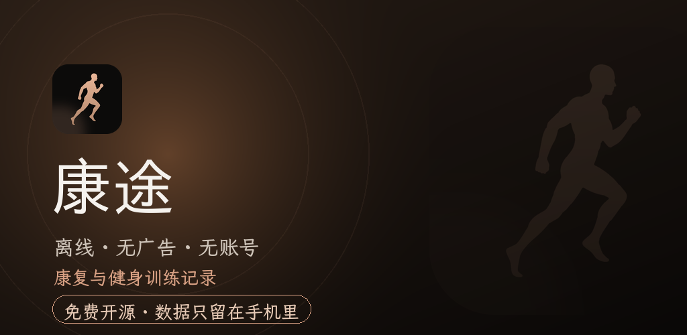

<br/>

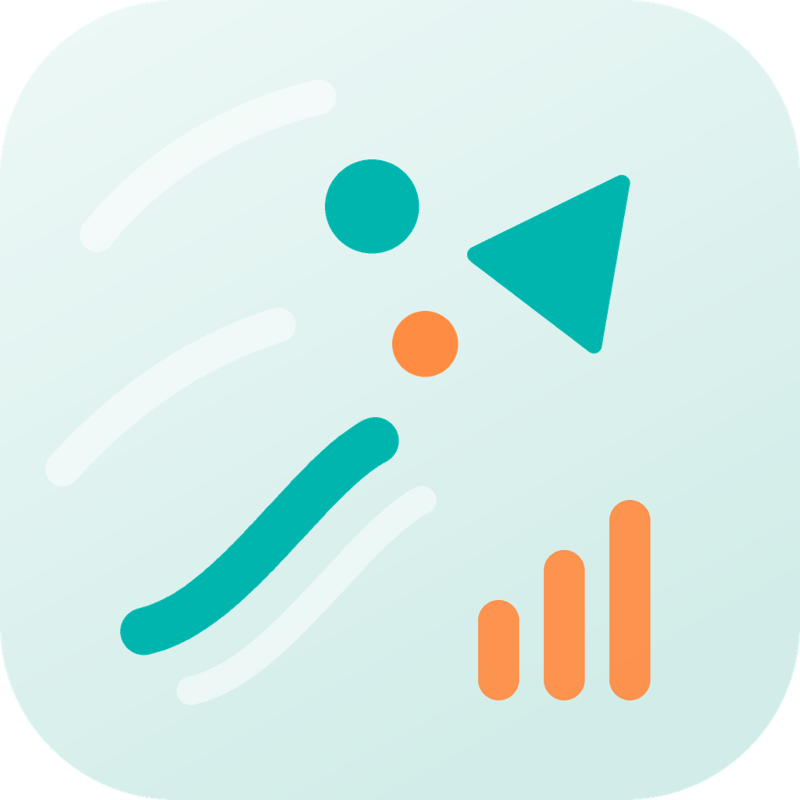

# 康途

一款免费、离线优先的 Android 康复与健身训练记录应用（唯一联网功能为「检查更新」）。<br/>
点选想练的肌群，记录每一组，看着你的数据一路上涨。

<br/>
<br/>

<details>
<summary><sub><b>界面截图</b>，全部来自真机</sub></summary>
<br/>

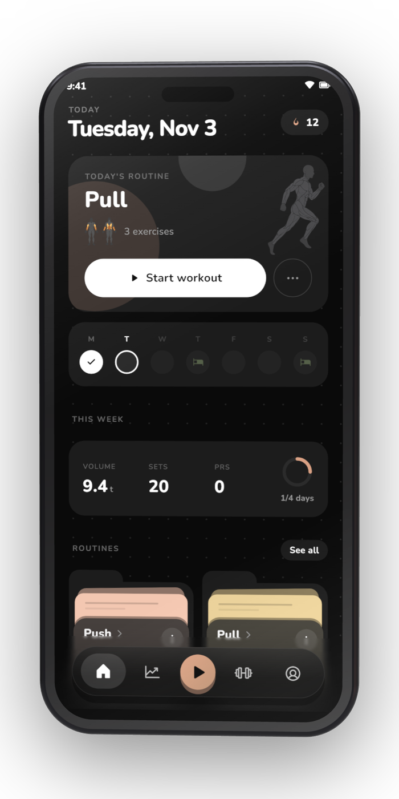
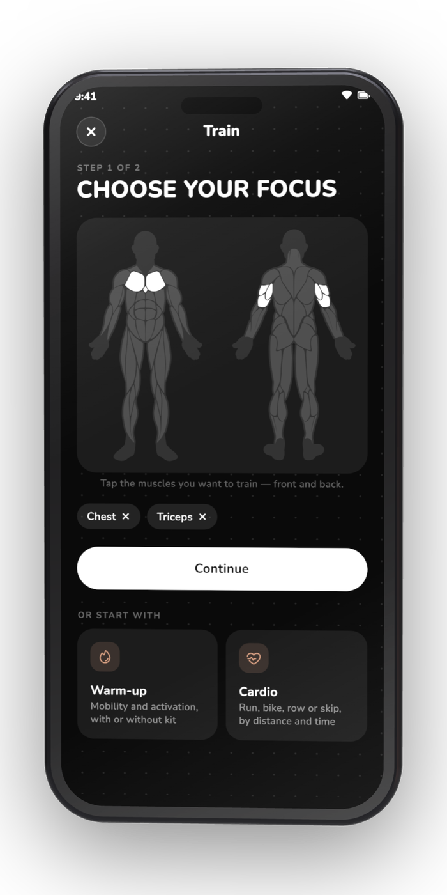
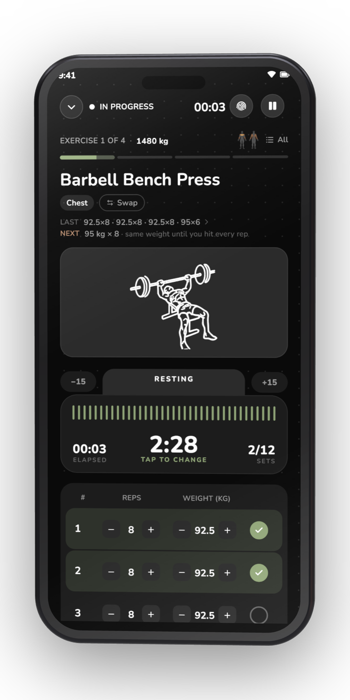
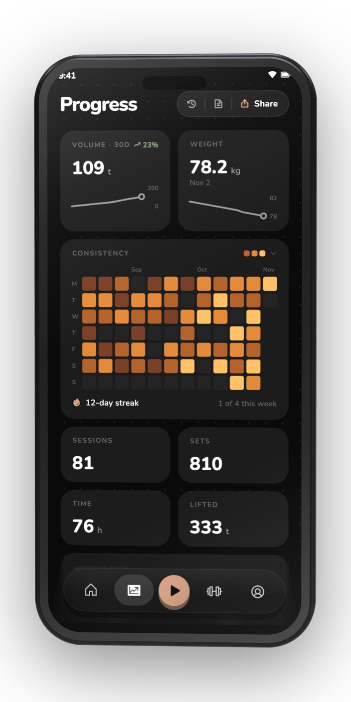

<sub><b>首页</b> &nbsp;·&nbsp; <b>人体图谱</b> &nbsp;·&nbsp; <b>训练进行中</b> &nbsp;·&nbsp; <b>进度统计</b></sub>

<br/>
<br/>

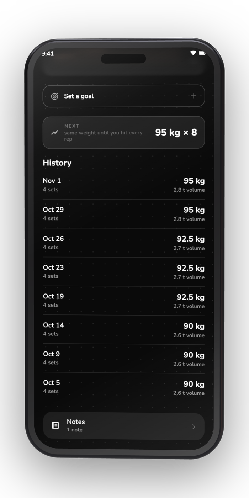
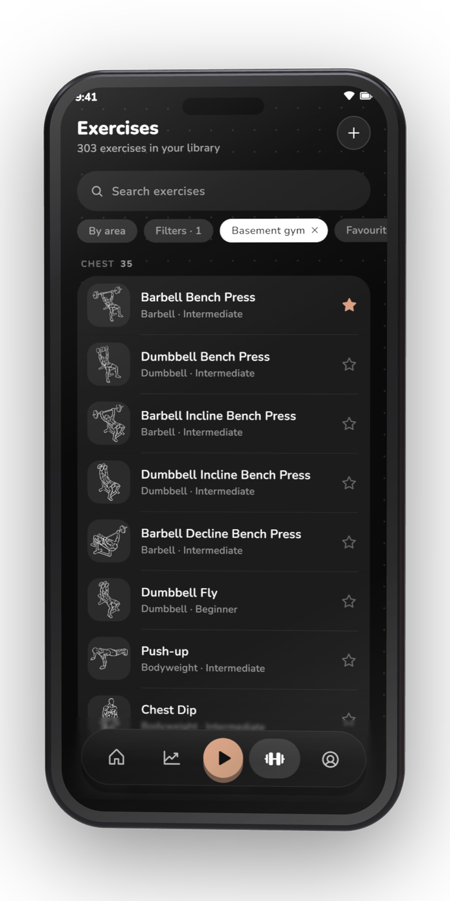
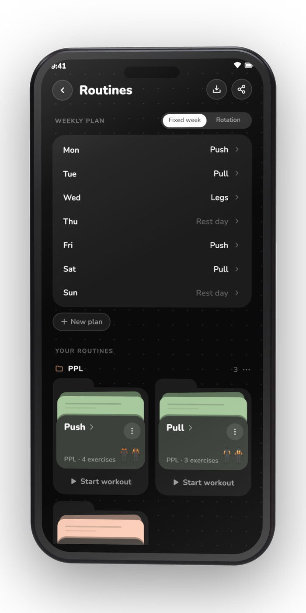
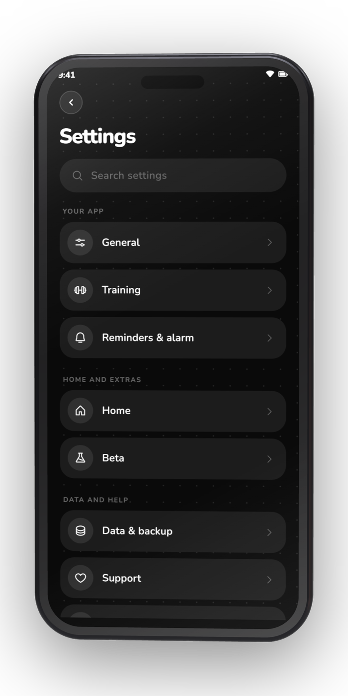

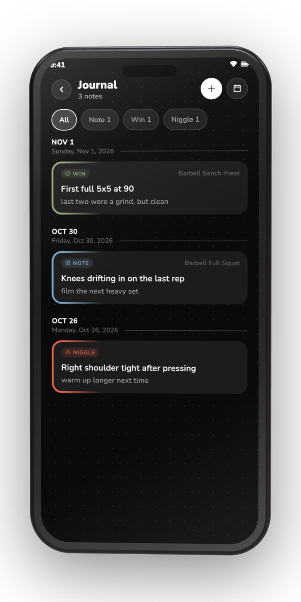
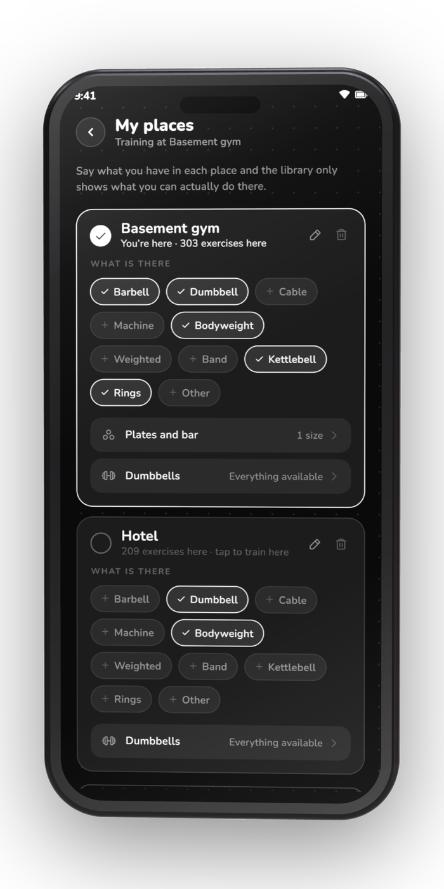
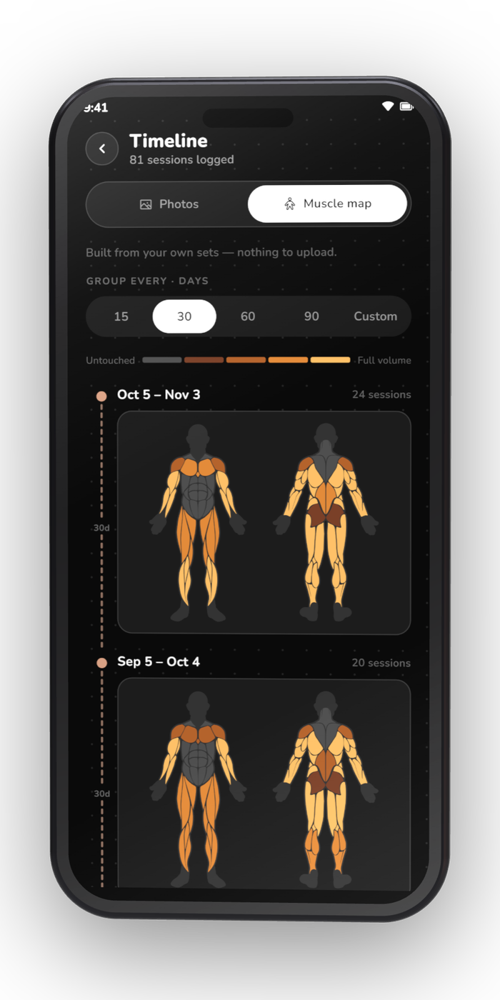
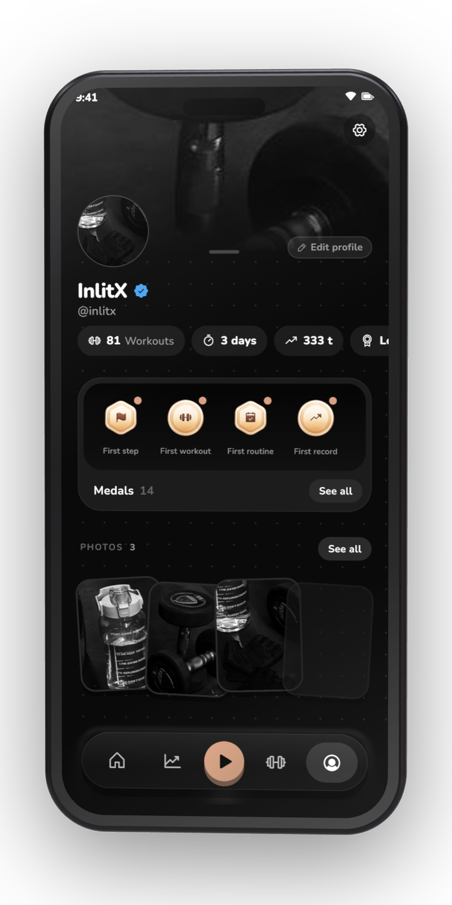

<sub><b>训练历史</b> &nbsp;·&nbsp; <b>动作库</b> &nbsp;·&nbsp; <b>训练计划</b> &nbsp;·&nbsp; <b>设置</b></sub>

</details>

</div>

## 这是什么

康途是一款面向**康复与健身训练**的本地记录应用：在人体图谱上点选想练的肌群，跟着计划完成每一组，
数据全部留在自己的手机上。无账号、无广告、无统计、无追踪；唯一的联网行为是你手动点「检查更新」（详见[隐私](#隐私)）。

本项目基于 [InlitX](https://github.com/InlitX/GymMane) 的 GymMane（GPL-3.0）二次开发，
针对康复训练场景做了中文本地化和功能增强，详细署名见文末[许可证](#许可证)。

## 功能

<table>
<tr>
<td width="50%" valign="top">

### 训练

- **人体图谱**，正面和背面：点一下想练的部位
- 次数、重量，以及可用自定义铃声的**组间休息计时器**
- **组类型**（热身组、正式组、递减组、力竭组），以及 RPE 或 RIR
- **超级组**：把一个动作和下一个串起来，跳过中间的休息
- **每侧配重片**，按你手头的器材自动计算
- 可分组、复制和排期的**训练计划**，一天也可以安排多个，还有现成的方案
- **下一步**：某个动作练得轻松了，就推荐更难的那个
- **排期周期**与**减载周**：按周排计划，到点自动降负荷
- **备选动作**：一个动作可以挂几个替补，器械被占了就换一个
- **计时循环**训练，以及**训练语音**报下一组和休息倒计时
- 带休息倒计时的**实时通知**，手机重启后训练也不会丢失

</td>
<td width="50%" valign="top">

### 康复

- **康复档案**：记录不适部位、程度、病程、加重 / 缓解因素，以及你自己填的「限制与禁忌」
- **安全门**：命中红旗征且没有记录医嘱时，**不接受任何训练计划**，只保留记录并提示就医
- **训练后反馈**：整体感觉 + 不适部位 + 备注，联动康复档案
- **AI 提示词**：导出你的情况交给通用 AI，再把回答导回应用；提示词里写死了保守规则
  （训练中疼痛不超过 3/10、先活动度再稳定性最后力量、必须遵守你填的限制与禁忌、
  与医嘱冲突时以医嘱为准、未过安全门时只给注意事项不给计划）
- 近期反馈会一并放进提示词（近 7 天，没有就取最近 3 次），让 AI 看趋势而不是单次波动
- 说清楚边界：**应用内没有动作禁忌过滤表**。「避开风险」靠三道共同完成 ——
  安全门硬拦、提示词里的保守规则（由外部 AI 执行）、你自己填的限制与禁忌；
  应用本身不会根据部位自动筛掉危险动作。
- 内置**康复手册**目前只收录腰痛一套 12 周方案（离线可看）；其他部位走上面的提示词流程

</td>
</tr>
<tr>
<td width="50%" valign="top">

### 进度

- 训练量、连续打卡、每周目标和**个人纪录**，全部来自你自己的组数
- **活动热力图**、每周节奏和累计总数
- 带 1RM 估算的**力量曲线**，以及肌群分布
- 时间线上的**进度照片**，也可以把同一条时间线画成肌群图
- 体重和**十项身体围度**，每项都有自己的曲线
- **月度回顾**：把一个月做成可以分享的故事页
- **健康数据**（可选）：从 Health Connect 读取步数、心率、睡眠、血氧等
- 带等级和 **21 枚奖牌**的**个人资料**
- 把训练做成**贴纸**放到照片上分享

</td>
<td width="50%" valign="top">

### 动作与工具

- **2500+ 个动作**，配有动画和分步说明（472 个来自上游，其余为扩充库条目；跨源重复已合并）
- 按肌群、器材和难度筛选，也能**创建自己的动作**
- 任何动作的插图都可以换成**你自己的照片、GIF 或视频**
- **场地**：告诉它你有哪些器材，只推荐用得上的动作
- 日历形式的**训练日志**，支持照片、视频和**文件夹**归类
- **十个计算器**：1RM、杠铃片、BMI、卡路里、体脂率、FFMI、热身组、RPE 换算、力量水平（DOTS）、Wilks
- **八个桌面小组件**：今天、本周、统计、卡路里、蛋白质、饮水、身体和活动热力图
- **饮食记录（Beta，默认关闭）**：在「设置 → 饮食」里开启。记餐食、饮水、蛋白质与补剂，
  内置 500+ 种带图食物（可自加、可改数值），还有**间歇性禁食**计时
- **饮食模块不扫码、不联网**：扫码需要在线食物库，等于把「你吃什么、什么时候吃」送到别人的服务器；
  这里的食物数据只存在你手机上，代价是要手动记

</td>
</tr>
<tr>
<td width="50%" valign="top">

### 你的数据

- 把训练导出为 **CSV** 或包含照片和视频的完整 **ZIP 备份**，也能再导入回来
- 把一段时间的训练导出成**报告**（PDF 或 CSV），进度页和设置页都能进
- 从 **Hevy**、**Strong**、**Lyfta**、**FitNotes**、**openGym** 或任意 CSV
  导入历史记录
- 把一次训练导出为 `.fit` 文件，上传到 **Strava**
- **AI 训练计划**：导出动作列表，粘贴到任意 AI，再把回答导入
- 无账号、无广告、无统计分析；联网只发生在你手动点「检查更新」时
- 照片、视频和笔记都保存在应用自己的存储空间里
- **17 种语言**，浅色和深色主题，kg 或 lb
- 一键删除全部数据

</td>
</tr>
</table>

## 下载

从 [GitHub Releases](https://github.com/Howezzzzz/kangtu-rehab/releases) 获取；
如果暂时还没有正式 Release，可以在 [Actions](https://github.com/Howezzzzz/kangtu-rehab/actions)
里下载最新一次构建产出的 APK。不确定选哪个的话，就下载 `arm64-v8a`。

| 平台 | 状态 |
|---|---|
| Android 7.0+ | 已支持 |
| Wear OS 3+ | 手表界面已随包内置，尚未做真机验证 |
| iOS 15+ | 开发中 |
| 桌面端 | 计划中 |

### 从 1.3.0.35 及更早版本升级（包名变更，务必先备份）

自 **1.4.0** 起，康途的应用包名由 `com.gymmane.app` 改为 **`com.kangtu.app`**。
换名后 Android 会把它当成**另一个应用**：装完桌面会多出一个图标、新版首次打开是空的，
旧版数据也**无法自动迁移**（Android 沙箱禁止跨应用读取数据目录）。

升级步骤：

1. 打开**旧版**康途 →「设置 → 备份」→ 导出 ZIP（含照片/视频）
2. 安装新版 APK（包名 `com.kangtu.app`）
3. 在新版里「导入备份」，选刚导出的那个 ZIP
4. 核对训练历史 / 康复档案 / 照片无误后，再卸载旧版

**需要重新授权或重新添加**：Health Connect 权限、通知权限、桌面小组件、精确闹钟。

为什么要换：旧包名与上游 [GymMane](https://github.com/InlitX/GymMane) 相同、但签名不同 ——
装过上游的设备装不上康途，两个应用也无法共存；换名后可以共存，显示名「康途」与包名也一致了。

## 隐私

无账号、无广告、无统计分析、无追踪。训练记录、康复档案、照片和笔记都只存在手机上。

康途确实申请了几项权限，逐项说明：

| 权限 | 用途 |
|---|---|
| `INTERNET` | **只在你手动点「设置 → 检查更新」时**联网：读取仓库里的版本号文件（含国内镜像），并可选下载更新包。启动时不会自动联网 |
| `REQUEST_INSTALL_PACKAGES` | 下载完更新包后调起系统安装界面 |
| Health Connect（15 项读取 + 1 项写入） | 「健康数据」是**可选**功能：开启后由系统逐项弹窗授权，读取步数、心率、睡眠、血氧等；同时你的训练会作为**运动记录写回** Health Connect。不开启就完全不碰，读取与写入都只发生在本机 |
| 通知 / 精确闹钟 / 开机自启 | 组间休息计时与训练提醒，手机重启后提醒不丢 |
| 存储 | 导出备份、把图片保存到相册 |

`ACCESS_NETWORK_STATE` 已在 Manifest 中显式移除（`tools:node="remove"`）。

**康复档案里会有医疗相关信息**（不适部位与程度、疼痛评分、医生建议、复诊时间）。这些内容全部只存在本机，
不上传、不给任何第三方；导出 ZIP 备份时会一并包含，请自行妥善保管备份文件。

动作库中的一部分条目来自 [RepDB](https://repdb.co) free tier，署名保留在应用内的关于页。

## 参与贡献

欢迎提交问题反馈、想法和 Pull Request。较大的改动请先开一个 issue 讨论。

```bash
git clone https://github.com/Howezzzzz/kangtu-rehab.git
cd kangtu-rehab
flutter pub get
flutter build apk --release
```

## 许可证

代码采用 [GPL-3.0](LICENSE)，并附有其第 7(b) 条规定的一项[附加条款](ADDITIONAL_TERMS.md)：
基于本项目的作品须注明 "Based on GymMane by InlitX"（原文照录，出自上游
InlitX/GymMane）。动作插图来自 Bryl Lim 的
[Workout Guide](https://github.com/bryllim/workout-guide)，以及它所基于的
[Everkinetic](https://github.com/everkinetic/data)，采用
[CC BY-SA 4.0](https://creativecommons.org/licenses/by-sa/4.0/) 许可。字体使用 SIL Open
Font License。详情见 [CREDITS.md](CREDITS.md)。
