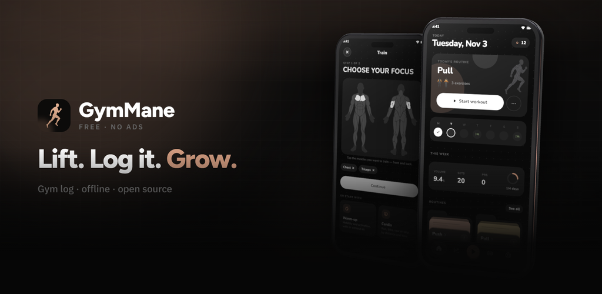
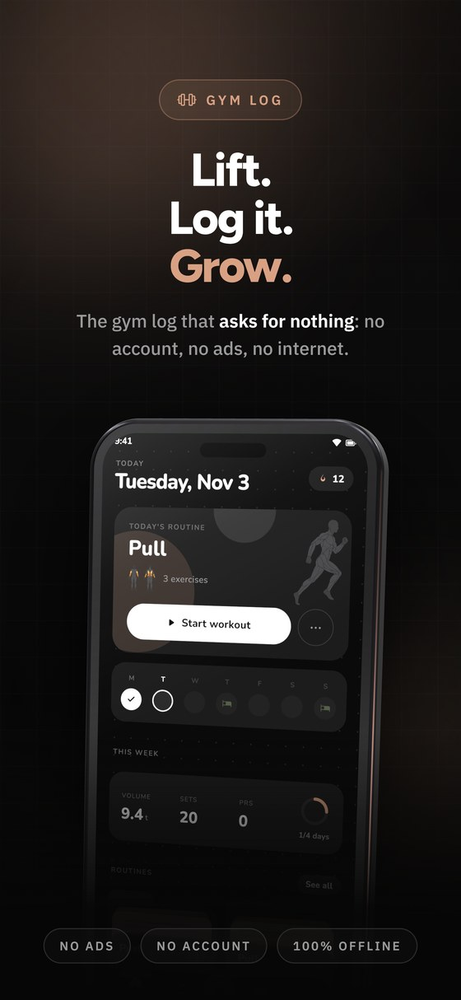
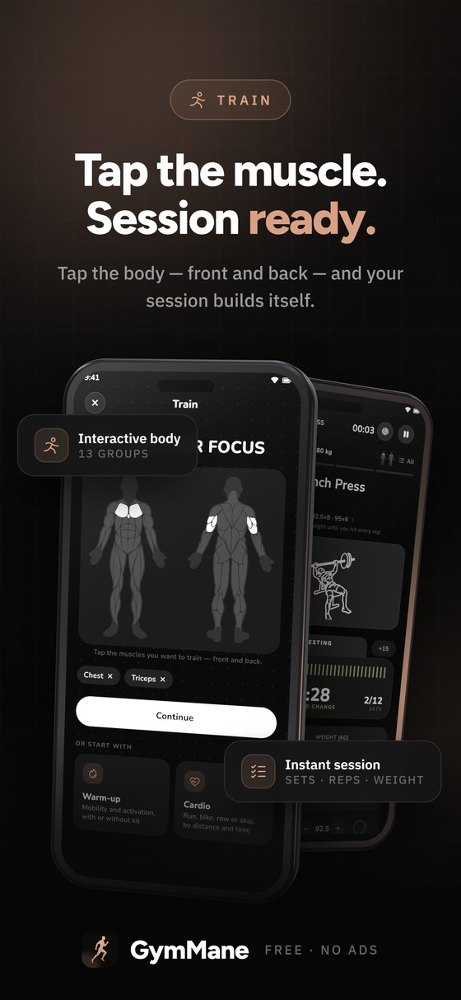
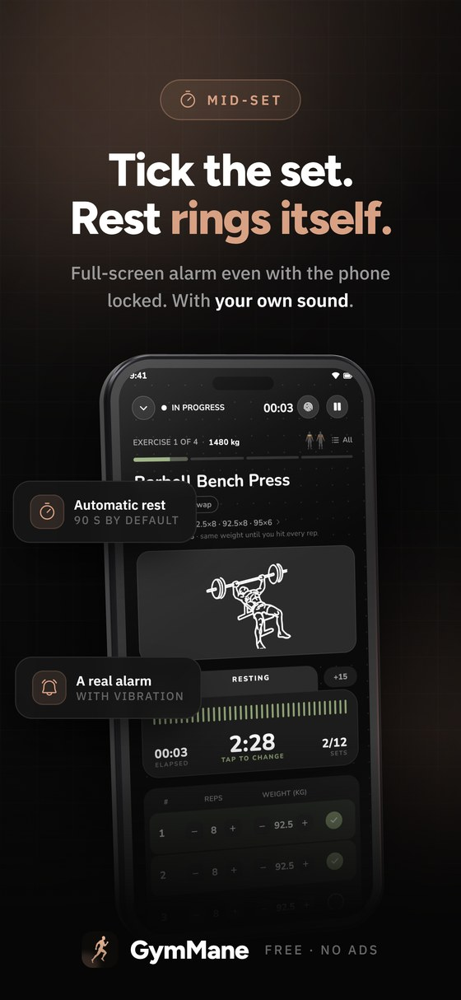
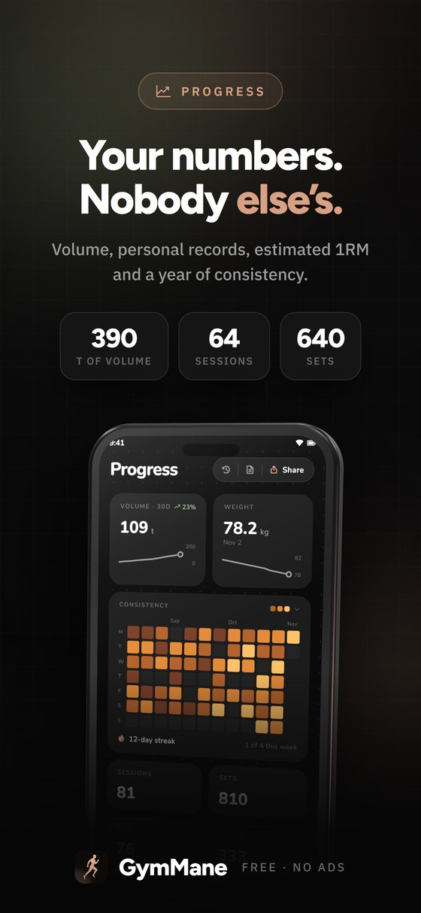
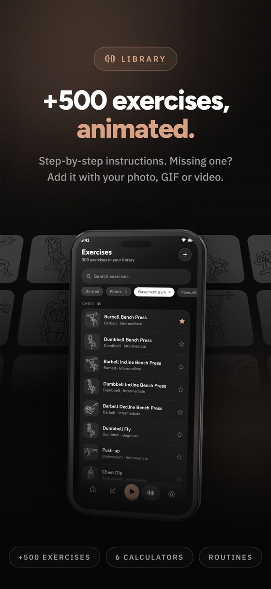
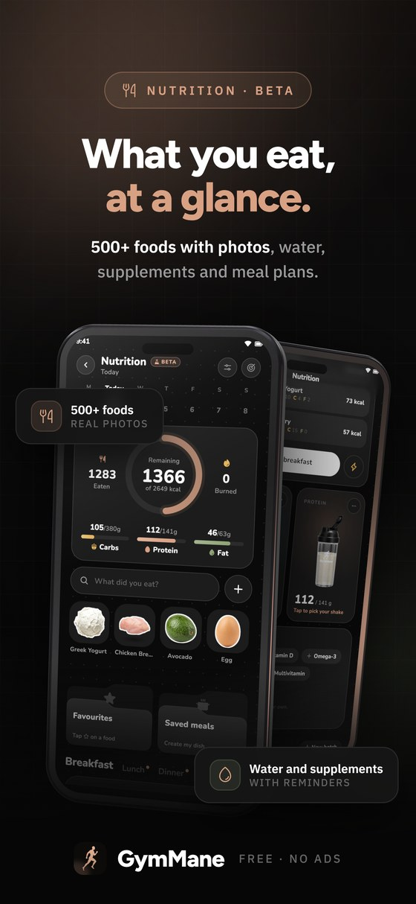
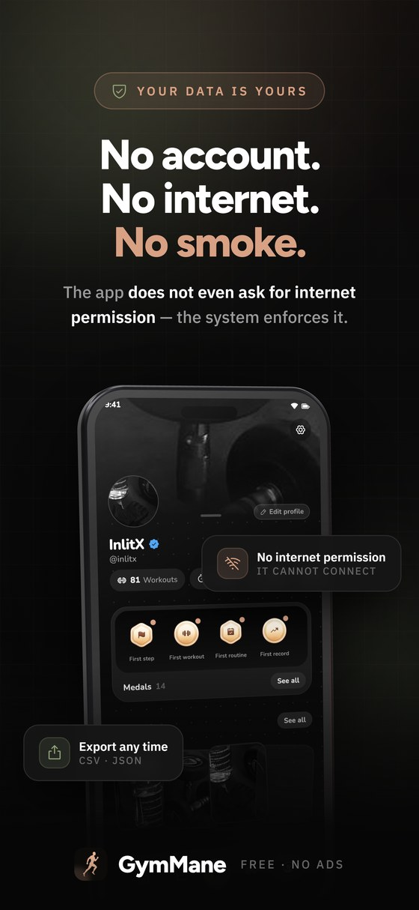

<div align="center">



<br/>


# GymMane

A free, offline gym log for Android.<br/>
Tap the muscles you want to train, log your sets and watch your numbers go up.

<br/>

<p>
  
  
  
  <a href="https://github.com/InlitX/GymMane/stargazers"></a>
  <a href="https://github.com/InlitX/GymMane/releases"></a>
</p>

<p>
  <a href="https://trendshift.io/repositories/107197?utm_source=repository-badge&amp;utm_medium=badge&amp;utm_campaign=badge-repository-107197" target="_blank" rel="noopener noreferrer"></a>
</p>

**下载**：从 [GitHub Releases](https://github.com/Howezzzzz/kangtu-rehab/releases) 获取 —— 本项目自行分发，未上架 F-Droid / IzzyOnDroid / OpenAPK 等商店。
&nbsp;
&nbsp;
&nbsp;
<a href="https://github.com/InlitX/GymMane/releases"></a>
&nbsp;

<sub><b>English</b> · <a href="docs/readme/README.es.md">Español</a> · <a href="docs/readme/README.it.md">Italiano</a> · <a href="docs/readme/README.zh.md">简体中文</a></sub>

<br/>
<br/>










<details>
<summary><sub><b>Plain screenshots</b>, every screen straight off the phone</sub></summary>
<br/>


<sub><b>Today</b> &nbsp;·&nbsp; <b>Body map</b> &nbsp;·&nbsp; <b>Live session</b> &nbsp;·&nbsp; <b>Progress</b></sub>

<br/>
<br/>


<sub><b>History</b> &nbsp;·&nbsp; <b>Library</b> &nbsp;·&nbsp; <b>Routines</b> &nbsp;·&nbsp; <b>Settings</b></sub>

</details>

</div>

## What it does

<table>
<tr>
<td width="50%" valign="top">

### Training

- Tap the muscles on a **body map** and get a session
- Reps, weight and a **rest timer** with your own sound
- Warm-up, drop, failure, rest-pause and cluster sets, with RPE or RIR
- **Supersets** and **plates per side**
- **Routines** and weekly plans, or a rotation
- **Progression** per exercise, so the app sets your next weights

</td>
<td width="50%" valign="top">

### Progress

- Volume, streaks, weekly goal and **PRs**
- **Strength curves** with estimated 1RM and strength per bodyweight
- An **activity heatmap** and a muscle map of what you trained
- **Progress photos** on a timeline
- Bodyweight and **ten body measurements**
- Levels, **medals** and a sticker to share your workout

</td>
</tr>
<tr>
<td width="50%" valign="top">

### Exercises and tools

- **500+ exercises** with animations and instructions
- Browse by muscle, equipment or level, or add **your own**
- Use **your own photo, GIF or video** for any exercise
- **Places**: tell it your kit and it only suggests what fits
- A **training journal** with photos and video
- Six **calculators** and five **widgets**

</td>
<td width="50%" valign="top">

### Your data

- **CSV** export and a full **ZIP backup**
- Import from **Hevy**, **Strong**, **Lyfta**, **FitNotes** or **openGym**
- Send workouts to **Strava** as a `.fit` file
- No account, no ads, no analytics, no **internet permission**
- **17 languages**, light and dark, kg or lb
- Delete everything in one tap

</td>
</tr>
</table>

## Nutrition (beta)

Calories and macros against your goal, 500+ foods with photos, your own foods
and dishes, water, protein shakes, supplements, meal plans and meal prep. No
scanner and no online database. Don't need it? Turn it off in
**Settings › Beta**.

## Download

Get it from F-Droid, IzzyOnDroid, OpenAPK, Obtainium or the
[GitHub releases](https://github.com/InlitX/GymMane/releases/latest). Not sure
which APK? Take `arm64-v8a`.

| Platform | Status |
|---|---|
| Android 7.0+ | Supported |
| Wear OS 3+ | In progress |
| iOS 15+ | In progress |
| Desktop | Planned |

## Privacy

GymMane doesn't have the internet permission, so your training never leaves
your phone. The permissions it asks for are for the rest timer, its
notification and the widgets.

## Contributing

Bug reports, ideas and pull requests are welcome. For anything big, open an
issue first. Want to translate? Edit your language's file and send a pull
request, [TRANSLATING.md](TRANSLATING.md) shows how.

```bash
git clone https://github.com/InlitX/GymMane.git
cd GymMane
flutter pub get
flutter build apk --release
```

## Support

GymMane is free and will stay that way. A star, a translation or a clear bug
report helps a lot. If you want to buy me a coffee:

<div align="center">

<a href="https://ko-fi.com/inlitx"></a>

<table align="center">
  <tr>
    <td align="center" width="130"><br/><sub><b>Bitcoin</b></sub></td>
    <td><code>bc1qm0r4pg8nknnjh3a7n2t63ckafhsz8jdd6qer29</code></td>
  </tr>
  <tr>
    <td align="center" width="130"><br/><sub><b>Ethereum</b></sub></td>
    <td><code>0x34b7A5552132cBca150Ae29c1E632faA49430e1a</code></td>
  </tr>
  <tr>
    <td align="center" width="130"><br/><sub><b>Solana</b></sub></td>
    <td><code>DC8dNEUNJhWdtBHBZAn4FTheVC3W4PtkGhbazvtk17Jo</code></td>
  </tr>
  <tr>
    <td align="center" width="130"><br/><sub><b>Monero</b></sub></td>
    <td><code>44SECMEf3rfV228kpy3Gs48wLmLXnq231gAMG7ULYoCWBWLYLHdwYV7YFkhMk31DR5P7SRAyRPyhkYaehtgEoajASz7qubq</code></td>
  </tr>
</table>

</div>

## License

The code is [GPL-3.0](LICENSE), with one [additional term](ADDITIONAL_TERMS.md)
under its section 7(b): works based on GymMane must credit it as "Based on
GymMane by InlitX". The exercise art comes from
[Workout Guide](https://github.com/bryllim/workout-guide) by Bryl Lim and from
[Everkinetic](https://github.com/everkinetic/data), the drawings Workout Guide
builds on, and is
[CC BY-SA 4.0](https://creativecommons.org/licenses/by-sa/4.0/). The fonts use
the SIL Open Font License. [CREDITS.md](CREDITS.md) has the details.

## Star history

<a href="https://www.star-history.com/?repos=inlitx%2Fgymmane&type=date&legend=top-left">
 <picture>
   <source media="(prefers-color-scheme: dark)" srcset="https://api.star-history.com/chart?repos=inlitx/gymmane&type=date&theme=dark&legend=top-left" />
   <source media="(prefers-color-scheme: light)" srcset="https://api.star-history.com/chart?repos=inlitx/gymmane&type=date&legend=top-left" />
   
 </picture>
</a>
